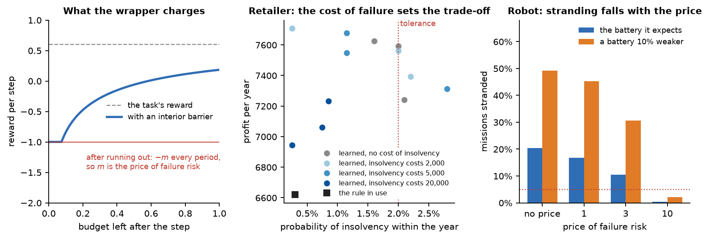

# bpg: reinforcement learning when a resource can run out

**Keep the learner you use. Add the budget. Know how often the trained policy runs out, and show it.**


Many control and decision problems have a resource that can run out: the fuel of a lander, the charge of a robot's
battery, the cash of a firm, an allowance of damage or emissions. Running out is a failure, and the question after
training is always the same: how often does the policy we deploy run out, and can we show it?

`bpg` answers it for any policy-gradient learner. A wrapper turns the budget into part of the problem: the policy
observes what is left, the episode ends when it runs out, and a price is charged at that moment. You train PPO, SAC
or any other learner on the wrapped environment unchanged. The toolbox then validates the policy you deploy with an
exact statistical test and writes a report that says what the evidence shows and what it does not.



## Four problems, four notebooks

Each notebook starts from a problem as a practitioner meets it and builds it in the open: the resource and the
budget, the requirement, the price, the wrapper and a check of it, the training code (run live on a short budget),
the regularizers, the validation and the report. Short notes say what the theory behind the method implies at each
step. The comparisons use the shipped policies of each problem's full campaign, so every notebook runs in minutes.

| Notebook | Problem | What it shows |
|---|---|---|
| [1. Lander with a fuel tank](notebooks/01_lander_fuel_tank.ipynb) | Gymnasium's LunarLander with a tank smaller than its controller needs | adding a budget to a task you already train; continuing from a controller in use, and what to anchor to |
| [2. Retailer with a cash balance](notebooks/02_retailer_cash.ipynb) | a three-line retailer that pays suppliers from cash; insolvency is the failure | writing your own simulator; a resource that is also replenished; a failure with a known cost; a rule in use as the prior and as a benchmark |
| [3. Robot on a battery](notebooks/03_robot_battery.ipynb) | MuJoCo's HalfCheetah with a battery whose efficiency varies by mission | what the policy must observe (a clock), the price, and a reserve margin against a battery that holds less than expected |
| [4. Navigation with a damage allowance](notebooks/04_navigation_allowance.ipynb) | Safety-Gymnasium's PointGoal1 with its cost limit read as an allowance | which requirement a task means; a price that charges more than an episode earns |

The [practitioner guide](docs/practitioner-guide.md) goes through the same decisions step by step, with what the
theory behind the method implies for each.

## Install

```bash
git clone <this repository> bpg-toolbox && cd bpg-toolbox
python -m venv ~/.venvs/bpg-toolbox && source ~/.venvs/bpg-toolbox/bin/activate
pip install -e ".[all]"      # core + Gymnasium (Box2D, MuJoCo), Stable-Baselines3, PyTorch, Jupyter, pytest
python tests/run_all.py --rl
```

The core needs only numpy and scipy (`pip install -e .`). The navigation problem needs Safety-Gymnasium, which pins
older versions of Gymnasium and MuJoCo; use a separate environment for it (see the notebook).

## Sixty seconds: validate a policy and read the verdict

```python
from bpg import Requirement, Stage, evaluate, interpret
from bpg.problems.inventory import Retailer, make_inventory_env, BaseStockRule

retailer = Retailer()                                   # three product lines, 52 weeks, starting cash 2,500
spec = retailer.spec()                                  # the budget is the cash; failure is the first week with negative cash
req = Requirement(T=51, alpha=0.02, zeta=0.05)          # insolvency within the year: at most 2%, at 95% confidence
stage = Stage(m=0.0, penalty="multiplier", multiplier=5000.0, clip_utility=False)   # insolvency costs 5,000

rule = BaseStockRule(retailer, cover=2.0, reserve=300.0)   # any callable obs -> action: a rule or a trained network
ev = evaluate(lambda: make_inventory_env(stage, retailer), rule.deterministic, 2000, spec=spec, stage=stage, T=51)
print(interpret(spec, req, stage, ev, candidate_name="the base-stock rule").summary(resource="cash", period="weeks"))
```

```text
The base-stock rule was run on 2000 fresh episodes. It ran out of cash within 52 weeks in 6 of them (0.30%).
With confidence 0.95, its probability of running out within 52 weeks is at most 0.591%.
Requirement (at most 2.00%): met.
Utility per episode: 6620 (standard error 73).
Episodes that came within 5% of running out, or ran out: 0.4%.

What this test does not show:
  - that the policy is the best possible at this risk: how far training fell short of the optimum is not measured;
  - its risk over more than 52 weeks, or that of other policies (its mean action, a retrained network);
  - its behavior outside the simulator.
Every bound with its assumptions: report.text().
```

## Your own problem

[`examples/your_problem.py`](examples/your_problem.py) is a complete template, from the task to the report, that runs
as it stands on LunarLander with a fuel tank; change the parts marked YOUR PROBLEM. In outline:

```python
import gymnasium as gym
from stable_baselines3 import PPO
from bpg import BudgetSpec, Requirement, Stage, BudgetWrapper, evaluate, interpret, plan
from bpg.callbacks import BudgetMonitor

def fuel_used(obs, action, next_obs, reward, info):     # the resource one step consumes (nonnegative)
    ...

spec = BudgetSpec(budgets=[24.0], beta=0.999, ubar=100.0, u_minus=100.0, horizon=1000)
req = Requirement(T=999, alpha=0.05, zeta=0.05, family=5)
stage = Stage(m=0.5, clip_utility=False)               # a price of 0.5 per step from a failure to the end of the episode
make_env = lambda st: BudgetWrapper(gym.make("LunarLanderContinuous-v3"), fuel_used, spec, st)

print(plan(spec, req, stage=stage).explain())          # another method?, validation size, checks
model = PPO("MlpPolicy", make_env(stage), gamma=spec.beta, ent_coef=0.0)
monitor = BudgetMonitor(spec.beta, stage.m, horizon=spec.horizon, check_every=20)   # records every batch
model.learn(3_000_000, callback=[monitor])
print(monitor.convergence().explain())                 # has the run stopped changing? monitor.plot() draws the curves
ev = evaluate(lambda: make_env(stage), lambda o: model.predict(o)[0], 1000, spec=spec, stage=stage, T=req.T)
print(interpret(spec, req, stage, ev, training=monitor.convergence()).summary())   # the verdict, and what it does not show
```

Regularizers that use a policy you trust (a parameter anchor, an action anchor, a prior fitted to a rule in use) are
optional; the template and notebooks 1 and 2 show them in code. The wrapper appends the remaining budget to the
observation, ends the episode when the budget is exhausted, and charges the price there. Options cover a reserve margin (`Stage(theta=...)`), a lump sum charged once at failure
(`Stage(penalty="multiplier", multiplier=F)`), an adaptive multiplier toward a tolerance (the `DualAscent`
callback), a budget that is smaller than the policy believes (`true_budget_scale=0.9`), and a resource that is also
replenished, such as cash (`RunningMaxCost`). The modules in [`bpg/problems/`](bpg/problems) show the mapping from a
task to a budget for each of the four problems and serve as templates.

## When to use another method

The method is a reasonable first choice when failures can be allowed in simulation and deployment tolerates a small
probability of failure or carries a known cost of failure. It is not claimed to outperform methods built for
particular constraint structures. Another method is the better choice when

1. **no failure is permissible** and a set of states from which failure can always be avoided is known (a safety
   layer, or a method with an infinite penalty);
2. **a prescribed tolerance must be met closely** and you can tune a multiplier's step (a Lagrangian method);
3. **violations during training matter** (constrained policy optimization);
4. **the loss grows with the size of the excess** (a constraint on the tail of the cumulative consumption);
5. **the model is known and small** (solve it exactly; the toolbox's validation applies to that policy too).

`plan(spec, req, ...)` states these cases for your problem before anything is trained.

## Under the hood

The method comes from the paper *The Price of Failure Risk: Clipped Barrier Policy Gradients with Convex
Regularization* (Malo, Viitasaari, Suominen, Vilkkumaa, Tahvonen). For readers who want to see the guarantees at
work, the [under-the-hood track](notebooks/under-the-hood/) runs the paper's test problems, which have exact
solutions: the price against an exact trade-off of utility and risk, training against an exact benchmark, the roles
of the regularizers on a solvable learning problem, and the validation in detail. The
[decisions and the theory behind them](docs/under-the-hood/decisions-and-theory.md) and the
[results map](docs/under-the-hood/results-map.md) connect each function to the result it implements; results are
cited by the paper's titles, never by numbers. The paper's own studies are reproduced in the separate replication
repository.

## Campaigns

[`campaigns/`](campaigns) holds the definitions, scripts and records of the four problems' training campaigns: one
command trains a configuration (`python campaigns/run.py retailer lump-5000 --seed 1`), and every record keeps the
training traces and the per-episode evaluation from which the notebooks rebuild their results.

## Citing

If you use the toolbox, please cite the paper and the software; [`CITATION.cff`](CITATION.cff) has the details.

## License

MIT; see [`LICENSE`](LICENSE).
